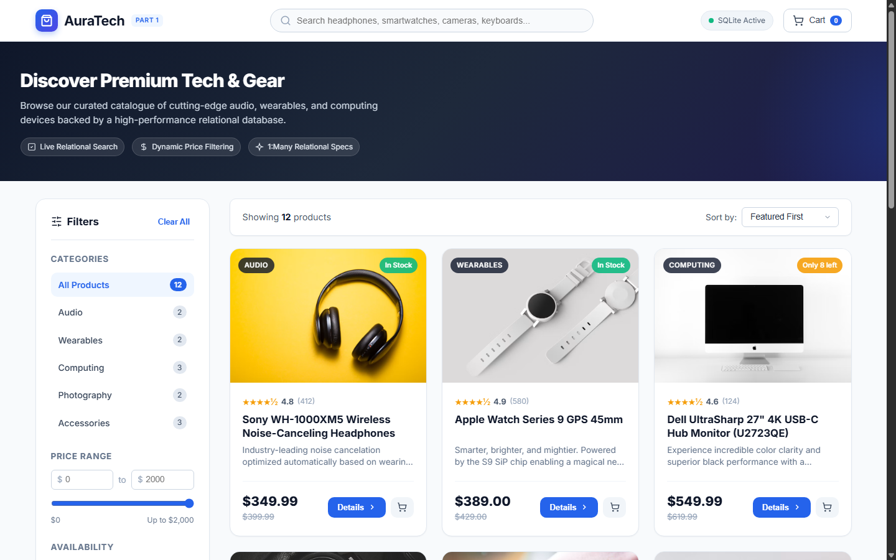
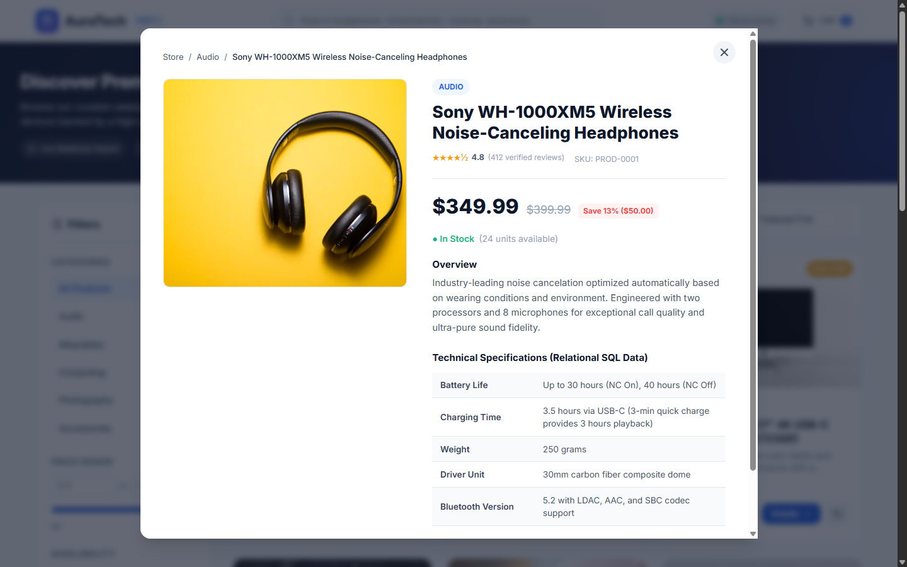

# Full-Stack E-Commerce Application — Part 1: Product Listing Website

A production-grade, modular, full-stack e-commerce application built for **Part 1 of the Lab Assignment**. This project delivers a responsive product catalogue website backed by an Express.js REST API and a relational SQLite database.

---

## Table of Contents
- [1. Overview & Objectives](#1-overview--objectives)
- [2. System Architecture](#2-system-architecture)
- [3. Technology Stack](#3-technology-stack)
- [4. Relational Database Design](#4-relational-database-design)
- [5. API Endpoints Documentation](#5-api-endpoints-documentation)
- [6. Application Screenshots](#6-application-screenshots)
- [7. Project Directory Structure](#7-project-directory-structure)
- [8. Prerequisites & Environment Setup](#8-prerequisites--environment-setup)
- [9. Installation & Running Instructions](#9-installation--running-instructions)
- [10. Automated API Testing](#10-automated-api-testing)
- [11. Roadmap to Part 2 & Part 3](#11-roadmap-to-part-2--part-3)

---

## 1. Overview & Objectives

This application fulfills all requirements outlined in **Part 1 — Product Listing Website**:
- **Frontend**:
  - Displays a dynamic product catalogue with names, descriptions, prices, categories, ratings, stock, and high-definition images.
  - Dedicated **Product Details Modal / Page** showing comprehensive information, reviews, and a relational technical specifications table.
  - Interactive **live search** (name & description) and **multi-criteria filtering** (category pills, price range slider/inputs, in-stock availability toggle, and sorting options).
  - Responsive design adapting smoothly across desktop, tablet, and mobile displays.
- **Backend**:
  - Built with Node.js and Express.js adhering to the Controller-Model-Router design pattern.
  - Exposes standard RESTful API endpoints for catalogue listing and single-item retrieval.
  - Enforces strict input validation on query parameters and route IDs, returning proper HTTP status codes (`200 OK`, `400 Bad Request`, `404 Not Found`, `500 Internal Server Error`).
- **Relational SQL Database**:
  - Powered by SQLite with strict relational integrity, foreign key constraints (`ON DELETE CASCADE`), and performance indexes.
  - Clean separation into `categories`, `products`, and `product_specifications` (1:Many relationship).
  - Complete `schema.sql` and `seed.sql` initialization scripts with realistic, diverse tech products.
  - Enforces backend data retrieval (the frontend communicates exclusively with backend API endpoints and never directly queries the database).
- **Single-Machine Integration**:
  - Fully integrated: a single command (`npm start`) initializes the database, mounts the REST API, and serves the static frontend assets.

---

## 2. System Architecture

The application adopts a decoupled, multi-tier architecture:

```
┌─────────────────────────────────────────────────────────────┐
│                       Client Layer                          │
│   (HTML5, CSS3 Custom Properties, Vanilla JavaScript SPA)   │
│   • Live Search & Multi-Filter Controls                     │
│   • Product Catalogue Grid & Details View / Modal           │
│   • REST API Client (Fetch API)                             │
└──────────────────────────────▲──────────────────────────────┘
                               │ HTTP / JSON
                               ▼
┌─────────────────────────────────────────────────────────────┐
│                      Backend Layer                          │
│               (Node.js / Express.js REST API)               │
│   • Request Validator Middleware (Sanity, Type Checking)    │
│   • Product & Category Controllers                          │
│   • Centralized Error & 404 Handlers                        │
│   • Static File Middleware (Serves UI)                      │
└──────────────────────────────▲──────────────────────────────┘
                               │ Parameterized SQL
                               ▼
┌─────────────────────────────────────────────────────────────┐
│                     Relational Database                     │
│                   (SQLite / SQL Engine)                     │
│   • categories (id, name, slug, description, icon)          │
│   • products (id, name, slug, description, price, stock...) │
│   • product_specifications (id, product_id, spec_name, ...) │
│   • Foreign Key Enforcement & Performance Indexes           │
└─────────────────────────────────────────────────────────────┘
```

---

## 3. Technology Stack

| Layer | Technology | Description |
| :--- | :--- | :--- |
| **Frontend** | HTML5, CSS3, Modern JS (ES6+) | Vanilla SPA with glassmorphism, responsive grid, live debounced search, modal routing, and toast notifications. Zero frontend build steps required. |
| **Backend** | Node.js, Express.js | Fast, minimalist web framework exposing validated REST API endpoints. |
| **Database** | SQLite (Relational SQL) | ACID-compliant relational SQL engine using `better-sqlite3` (with native `node:sqlite` fallback). |
| **Data Integrity** | Foreign Keys & Check Constraints | Enforces relational consistency, positive pricing, rating ranges, and non-negative stock counts. |
| **Testing** | Custom Node.js HTTP Test Suite | Automated integration tests verifying all endpoints, queries, filters, validations, and status codes. |

---

## 4. Relational Database Design

The relational database is defined in `database/schema.sql` and populated via `database/seed.sql`.

### Entity-Relationship (ER) Overview

```
 ┌────────────────┐         1:N          ┌────────────────────────┐
 │   categories   │──────────────────────┤        products        │
 ├────────────────┤                      ├────────────────────────┤
 │ id (PK)        │                      │ id (PK)                │
 │ name (UNIQUE)  │                      │ name                   │
 │ slug (UNIQUE)  │                      │ slug (UNIQUE)          │
 │ description    │                      │ description            │
 │ icon           │                      │ price                  │
 │ created_at     │                      │ original_price         │
 └────────────────┘                      │ image_url              │
                                         │ category_id (FK)       │
                                         │ stock_quantity         │
                                         │ rating                 │
                                         │ review_count           │
                                         │ featured               │
                                         │ created_at             │
                                         └───────────┬────────────┘
                                                     │ 1:N
                                                     ▼
                                         ┌────────────────────────┐
                                         │ product_specifications │
                                         ├────────────────────────┤
                                         │ id (PK)                │
                                         │ product_id (FK)        │
                                         │ spec_name              │
                                         │ spec_value             │
                                         │ created_at             │
                                         └────────────────────────┘
```

### Table Definitions

1. **`categories`**: Stores product classification metadata.
   - `id`: INTEGER PRIMARY KEY AUTOINCREMENT
   - `name`: TEXT NOT NULL UNIQUE
   - `slug`: TEXT NOT NULL UNIQUE (URL-friendly identifier)
   - `description`: TEXT
   - `icon`: TEXT

2. **`products`**: Stores core product attributes.
   - `id`: INTEGER PRIMARY KEY AUTOINCREMENT
   - `name`: TEXT NOT NULL
   - `slug`: TEXT NOT NULL UNIQUE
   - `description`: TEXT NOT NULL
   - `price`: REAL NOT NULL CHECK(price >= 0)
   - `original_price`: REAL CHECK(original_price IS NULL OR original_price >= price)
   - `image_url`: TEXT NOT NULL
   - `category_id`: INTEGER NOT NULL REFERENCES `categories(id)` ON DELETE RESTRICT
   - `stock_quantity`: INTEGER NOT NULL DEFAULT 0 CHECK(stock_quantity >= 0)
   - `rating`: REAL NOT NULL DEFAULT 0.0 CHECK(rating >= 0.0 AND rating <= 5.0)
   - `review_count`: INTEGER NOT NULL DEFAULT 0
   - `featured`: INTEGER NOT NULL DEFAULT 0 (1 = featured on homepage)

3. **`product_specifications`**: Stores normalized 1:Many technical specifications displayed on the product details view.
   - `id`: INTEGER PRIMARY KEY AUTOINCREMENT
   - `product_id`: INTEGER NOT NULL REFERENCES `products(id)` ON DELETE CASCADE
   - `spec_name`: TEXT NOT NULL (e.g., `Battery Life`, `Resolution`, `Weight`)
   - `spec_value`: TEXT NOT NULL

### Indexes
To optimize query performance during live catalogue filtering and sorting:
- `idx_products_category_id` on `products(category_id)`
- `idx_products_price` on `products(price)`
- `idx_products_rating` on `products(rating)`
- `idx_products_name` on `products(name COLLATE NOCASE)`
- `idx_specs_product_id` on `product_specifications(product_id)`

---

## 5. API Endpoints Documentation

All API responses return standardized JSON envelopes.

### Base URL
`http://localhost:5000/api`

### Summary Table

| Method | Endpoint | Description | Status Codes |
| :--- | :--- | :--- | :--- |
| `GET` | `/api/health` | Health check & database connection status | `200`, `503` |
| `GET` | `/api/products` | Retrieve catalogue with search, filter, and sort | `200`, `400`, `500` |
| `GET` | `/api/products/:id` | Retrieve single product with relational specifications | `200`, `400`, `404`, `500` |
| `GET` | `/api/categories` | Retrieve all categories with product count | `200`, `500` |

---

### Detailed Endpoint Specifications

#### 1. `GET /api/products`
Retrieves products matching query criteria.

**Query Parameters (Optional):**
- `search` (string): Search term matched against product `name` and `description`.
- `category` (string): Category slug (e.g. `audio`, `wearables`) or category ID.
- `minPrice` (number): Minimum price threshold (must be non-negative).
- `maxPrice` (number): Maximum price threshold (`maxPrice >= minPrice`).
- `inStock` (boolean): `true` to filter for products with `stock_quantity > 0`.
- `sortBy` (string): `featured`, `price_asc`, `price_desc`, `rating`, `name_asc`, `newest`.
- `page` (integer): Page number for pagination (default: `1`).
- `limit` (integer): Items per page (default: `20`, max: `100`).

**Success Response (`200 OK`):**
```json
{
  "success": true,
  "count": 2,
  "total": 2,
  "pagination": {
    "total": 2,
    "page": 1,
    "limit": 20,
    "totalPages": 1,
    "hasNext": false,
    "hasPrev": false
  },
  "data": [
    {
      "id": 1,
      "name": "Sony WH-1000XM5 Wireless Noise-Canceling Headphones",
      "slug": "sony-wh1000xm5-headphones",
      "description": "Industry-leading noise cancelation optimized automatically...",
      "price": 349.99,
      "original_price": 399.99,
      "image_url": "https://images.unsplash.com/photo-1505740420928-5e560c06d30e?...",
      "category_id": 1,
      "stock_quantity": 24,
      "rating": 4.8,
      "review_count": 412,
      "featured": 1,
      "category_name": "Audio",
      "category_slug": "audio"
    }
  ]
}
```

**Validation Error Response (`400 Bad Request`):**
```json
{
  "success": false,
  "error": "Invalid query parameters",
  "details": [
    "minPrice cannot be greater than maxPrice."
  ]
}
```

---

#### 2. `GET /api/products/:id`
Retrieves an individual product including its relational specifications.

**Path Parameters:**
- `id` (integer, required): Positive integer representing the product ID.

**Success Response (`200 OK`):**
```json
{
  "success": true,
  "data": {
    "id": 1,
    "name": "Sony WH-1000XM5 Wireless Noise-Canceling Headphones",
    "slug": "sony-wh1000xm5-headphones",
    "description": "Industry-leading noise cancelation optimized automatically...",
    "price": 349.99,
    "original_price": 399.99,
    "image_url": "https://images.unsplash.com/photo-1505740420928-5e560c06d30e?...",
    "category_id": 1,
    "stock_quantity": 24,
    "rating": 4.8,
    "review_count": 412,
    "featured": 1,
    "category_name": "Audio",
    "category_slug": "audio",
    "category_description": "High-fidelity headphones, wireless earbuds, and studio speakers",
    "specifications": [
      {
        "spec_name": "Battery Life",
        "spec_value": "Up to 30 hours (NC On), 40 hours (NC Off)"
      },
      {
        "spec_name": "Charging Time",
        "spec_value": "3.5 hours via USB-C (3-min quick charge provides 3 hours playback)"
      },
      {
        "spec_name": "Driver Unit",
        "spec_value": "30mm carbon fiber composite dome"
      }
    ]
  }
}
```

**Not Found Response (`404 Not Found`):**
```json
{
  "success": false,
  "error": "Product with ID 99999 not found."
}
```

**Invalid Parameter Response (`400 Bad Request`):**
```json
{
  "success": false,
  "error": "Invalid product ID format. ID must be a positive integer."
}
```

---

#### 3. `GET /api/categories`
Retrieves all product categories alongside active product counts.

**Success Response (`200 OK`):**
```json
{
  "success": true,
  "count": 5,
  "data": [
    {
      "id": 1,
      "name": "Audio",
      "slug": "audio",
      "description": "High-fidelity headphones, wireless earbuds, and studio speakers",
      "icon": "headphones",
      "product_count": 2
    },
    {
      "id": 2,
      "name": "Wearables",
      "slug": "wearables",
      "description": "Next-generation smartwatches, fitness bands, and wearable tech",
      "icon": "watch",
      "product_count": 2
    }
  ]
}
```

---

## 6. Application Screenshots

### 1. Product Listing Page
Shows the catalogue grid with live search, dynamic category pills with product counts, price range filtering, sorting options, and product cards with rating stars, pricing, and stock status:



---

### 2. Product Details View (Modal / Deep Link)
Shows the detailed product view opened via the "Details" button or direct URL (`/#/product/1`), including high-res imagery, rating reviews, breadcrumb navigation, price savings calculation, stock availability, full description, and the **relational technical specifications table**:



---

## 7. Project Directory Structure

```
ecommerce-fullstack/
├── .gitignore                      # Git ignore file (excludes node_modules, temp files, db journals)
├── README.md                       # Comprehensive setup and architecture documentation
├── package.json                    # Project configuration, dependencies, and NPM scripts
├── backend/
│   ├── server.js                   # Main Express application, static file serving, routes mounting
│   ├── controllers/
│   │   └── productController.js    # Controller handling HTTP requests and status codes
│   ├── middleware/
│   │   ├── errorHandler.js         # Centralized error handler and 404 handler
│   │   └── validator.js            # Validation middleware for query params and route IDs
│   ├── models/
│   │   └── productModel.js         # SQL queries for filtering, sorting, pagination, and details
│   └── routes/
│       ├── categoryRoutes.js       # Route definitions for /api/categories
│       └── productRoutes.js        # Route definitions for /api/products
├── database/
│   ├── schema.sql                  # Relational SQL schema DDL (categories, products, specs, indexes)
│   ├── seed.sql                    # SQL seed data populating realistic catalogue items
│   ├── db.js                       # SQLite database manager (connection, auto-seed, query execution)
│   ├── setup.js                    # Standalone database initialization CLI script
│   └── ecommerce.db                # SQLite database file (created automatically on setup/startup)
├── frontend/
│   ├── index.html                  # Semantic HTML5 single-page application entrypoint
│   ├── css/
│   │   └── styles.css              # Responsive modern design system and component styling
│   └── js/
│       ├── api.js                  # Frontend API client communicating with backend endpoints
│       └── app.js                  # Client application state, search/filter logic, modal, toasts
├── screenshots/
│   ├── product-listing.png         # Screenshot of the product listing view
│   └── product-details.png         # Screenshot of the product details view
├── scripts/
│   └── capture.ps1                 # Automated screenshot capture script using headless browser
└── test/
    └── api.test.js                 # 19 automated integration tests covering all API endpoints
```

---

## 8. Prerequisites & Environment Setup

To run this application locally, you only need:
1. **Node.js**: Version `18.x`, `20.x`, or `22.x` (LTS recommended).
2. **NPM**: Version `9.x` or newer (included automatically with Node.js).
3. **Web Browser**: Any modern browser (Google Chrome, Microsoft Edge, Mozilla Firefox, Safari).

*Note: No external database server (like MySQL or PostgreSQL) needs to be installed or running — SQLite runs in-process with zero external configuration.*

---

## 9. Installation & Running Instructions

Follow these step-by-step instructions to run the application on any single computer:

### Step 1: Clone or Navigate to the Repository
Open a terminal (PowerShell, Command Prompt, or Bash) and navigate to the project directory:
```bash
cd ecommerce-fullstack
```

### Step 2: Install Dependencies
Install the required Node.js packages:
```bash
npm install
```

### Step 3: Initialize the Relational Database
Create the database schema and populate it with sample products:
```bash
npm run db:init
```
*Output confirmation:*
```text
[Database] Initializing relational database at: .../database/ecommerce.db using [better-sqlite3]...
[Database] Schema created / verified successfully.
[Database] Seeding sample catalogue data...
[Database] Seed complete. 12 products in database.
```
*(Note: If you skip this step, the backend server will automatically create and seed the database on initial startup!)*

### Step 4: Start the Application Server
Start the Express server:
```bash
npm start
```
*Output confirmation:*
```text
====================================================
  E-Commerce Application Server is Running!
  Environment: development
  Local URL:   http://localhost:5000
  API Health:  http://localhost:5000/api/health
  Products:    http://localhost:5000/api/products
  Categories:  http://localhost:5000/api/categories
====================================================
```

### Step 5: Open in Your Browser
Open your browser and navigate to:
```
http://localhost:5000
```
- **Browse the catalogue**: Scroll through the loaded products.
- **Search**: Type in the top search bar (e.g., `Sony`, `Watch`, `Camera`, `Dell`).
- **Filter by Category**: Click category pills (`Audio`, `Wearables`, `Computing`, `Photography`, `Accessories`).
- **Filter by Price**: Drag the price range slider or enter min/max values.
- **Sort**: Change the sort dropdown to `Price: Low to High`, `Highest Rated`, etc.
- **Product Details**: Click the **Details** button on any card to open the rich modal with technical specifications.

---

## 10. Automated API Testing

An automated integration test suite is included in `test/api.test.js`. It boots an ephemeral test server and validates:
- Endpoint accessibility (`GET /api/health`, `GET /api/categories`, `GET /api/products`)
- Search filtering accuracy
- Category filtering accuracy
- Price range boundaries
- Sorting orders
- Relational specification retrieval on `GET /api/products/:id`
- HTTP status code `404` for missing IDs
- HTTP status code `400` for invalid ID formats
- HTTP status code `400` for conflicting price boundaries (`minPrice > maxPrice`)

To execute the test suite:
```bash
npm run test:api
```

**Expected Output:**
```text
======================================================
  Running Backend API & Integration Test Suite
======================================================

[API] GET /api/health -> 200 (14ms)
  [PASS] Health Check: GET /api/health returns 200 OK
[API] GET /api/products -> 200 (7ms)
  [PASS] Catalogue Retrieval: GET /api/products returns 200 OK
  [PASS] Catalogue Count: Contains products array
  [PASS] Catalogue Schema: First product has name, description, price, image_url
[API] GET /api/products?search=Sony -> 200 (2ms)
  [PASS] Search Filter: GET /api/products?search=Sony returns 200
  [PASS] Search Accuracy: Finds matching Sony product
[API] GET /api/products?category=audio -> 200 (3ms)
  [PASS] Category Filter: GET /api/products?category=audio returns 200
  [PASS] Category Accuracy: All returned items belong to Audio
[API] GET /api/products?minPrice=100&maxPrice=300 -> 200 (4ms)
  [PASS] Price Range Filter: GET /api/products?minPrice=100&maxPrice=300 returns 200
  [PASS] Price Range Accuracy: All items within $100-$300
[API] GET /api/products?sortBy=price_asc -> 200 (2ms)
  [PASS] Sorting: GET /api/products?sortBy=price_asc returns 200
  [PASS] Sorting Accuracy: Prices strictly in ascending order
[API] GET /api/products/1 -> 200 (3ms)
  [PASS] Product Detail: GET /api/products/1 returns 200 OK
  [PASS] Product Detail Specifications: Relational specs table attached
[API] GET /api/products/99999 -> 404 (1ms)
  [PASS] Status Code 404: Non-existent product ID returns 404
[API] GET /api/products/not-a-number -> 400 (2ms)
  [PASS] Status Code 400: Non-numeric ID returns 400 Bad Request
[API] GET /api/products?minPrice=500&maxPrice=200 -> 400 (1ms)
  [PASS] Status Code 400: minPrice > maxPrice returns 400 Bad Request
[API] GET /api/categories -> 200 (2ms)
  [PASS] Categories Endpoint: GET /api/categories returns 200 OK
  [PASS] Categories Product Count: Includes relational product_count field

------------------------------------------------------
  Tests Completed: 19 Passed, 0 Failed
------------------------------------------------------
```

---

## 11. Roadmap to Part 2 & Part 3

The architecture implemented in Part 1 is intentionally structured to scale directly into the subsequent assignment phases:
- **Part 2 (Cart & Authentication)**:
  - Add `users`, `carts`, and `cart_items` tables with foreign keys to `products`.
  - Add session / JWT authentication middleware.
  - Implement cart endpoints (`POST /api/cart`, `DELETE /api/cart/:id`).
- **Part 3 (Admin, Migrations, Logging & Monitoring)**:
  - Database schema migrations runner.
  - Winston / Morgan production request logging and Prometheus monitoring endpoints.
  - Role-based authorization (`admin` vs `customer`).

---

### Author & Submission Notes
- **Course**: Building a Full-Stack E-Commerce Application
- **Assignment**: Part 1 — Product Listing Website
- **Status**: Completed and fully verified
